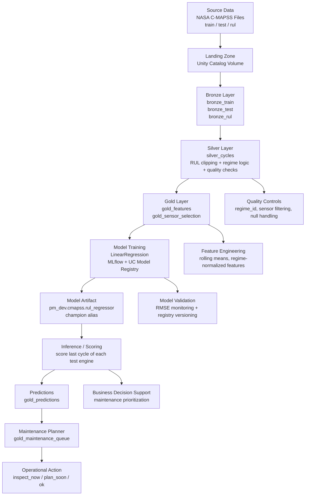

# Predictive Maintenance Analytics Platform

A Databricks-based predictive maintenance solution for turbofan engine health monitoring and maintenance planning. The platform ingests NASA C-MAPSS data, transforms it through a medallion architecture, trains a Remaining Useful Life (RUL) regression model, and produces a maintenance prioritization queue for operational decision-making.

## Overview

This repository demonstrates a complete end-to-end analytics workflow for predictive maintenance:

- ingest raw engine sensor data from NASA C-MAPSS files
- build a bronze layer with schema validation and raw persistence
- create a silver layer with engineered lifecycle features and quality checks
- generate gold features for model training and inference
- train and register an ML model with MLflow
- score the latest cycle for each engine and prioritize maintenance actions

The project is designed to run on Databricks using Unity Catalog, job orchestration, and a modular Python pipeline. It follows a clean medallion pattern and separates configuration, transforms, and model logic into maintainable components.

---

## End-to-End Project Flow



## Business Context

The solution is built for an operations team managing turbine or engine assets where failures are expensive and unplanned downtime creates significant cost and risk. The goal is to transition from reactive maintenance to proactive, condition-based intervention by forecasting when assets are likely to fail.

The model predicts Remaining Useful Life (RUL), and the results are converted into an operational queue that classifies assets into maintenance priority bands.

---

## Solution Architecture

### Data pipeline layers

1. Bronze layer
   - raw ingestion from NASA text files
   - typed and minimally processed tables
   - preserves source data for traceability

2. Silver layer
   - engineered lifecycle features
   - RUL clipping and cycle-level preparation
   - regime-aware transformations and quality assertions

3. Gold layer
   - curated modeling features
   - sensor selection and dimensional reduction
   - ready for training and scoring

4. ML layer
   - model training with scikit-learn
   - MLflow experiment tracking
   - Unity Catalog model registration

5. Operations layer
   - batch scoring for latest test-cycle predictions
   - maintenance planner queue for downstream action

---

## Repository Structure

```text
.
├── databricks.yml                 # Databricks bundle configuration
├── pyproject.toml                 # Python project metadata and tooling
├── requirements.txt               # Runtime dependencies
├── requirements-dev.txt           # Dev dependencies, linting, testing
├── README.md                      # Project documentation
├── CHANGELOG.md                   # Change history
├── data/
│   ├── README.md                  # Data placement guidance
│   └── raw/                      # Local NASA data copy (not committed in practice)
├── docs/
│   ├── PROJECT_FLOW.md            # Short project flow summary
│   ├── assumptions.md             # BRD assumptions and design decisions
│   └── findings.md                # Final stakeholder findings
├── notebooks/
│   ├── 00_setup.py                # Setup guidance
│   ├── 01_profile.py              # Data profiling and QA checks
│   ├── 02_planner_queue.py        # Maintenance queue SQL and output review
│   ├── 03_silver_checks.py        # Silver validation checks
│   ├── 04_gold_sensors.py          # Gold feature and sensor validation
│   └── 05_mlflow_review.py        # MLflow review and experiment inspection
├── resources/
│   ├── jobs.yml                   # Job definitions for ingestion, transform, train, score
│   └── pipelines.yml              # Pipeline configuration
├── sql/
│   └── planner_queue.sql          # Planner queue query logic
├── src/
│   ├── __init__.py
│   ├── columns.py                 # Sensor metadata and configuration
│   ├── path_setup.py              # Path setup helpers
│   ├── settings.py                # Project-wide configuration
│   ├── spark_utils.py             # Spark utilities
│   ├── ingestion/
│   │   ├── __init__.py
│   │   ├── load_bronze.py         # Bronze ingestion logic
│   │   └── parse.py               # NASA file parsing
│   ├── ml/
│   │   ├── __init__.py
│   │   ├── train.py               # Training and model registration
│   │   └── score.py               # Batch scoring and queue generation
│   ├── transforms/
│   │   ├── __init__.py
│   │   ├── build_gold.py          # Gold feature construction
│   │   ├── build_silver.py        # Silver transform logic
│   │   ├── features.py            # Feature engineering utilities
│   │   ├── quality.py             # Validation and quality rules
│   │   └── rul.py                 # RUL calculation logic
│   └── ...
├── tests/
│   ├── test_features.py           # Feature engineering tests
│   ├── test_rul.py                # RUL calculation tests
│   └── test_settings.py           # Settings validation tests
└── .github/                       # CI/CD workflows and templates
```

---

## Key project jobs and artifacts

The Databricks Asset Bundle defines the operational workflow:

1. `pm-ingest-bronze`
   - loads raw NASA files into the bronze layer

2. `pm-transform-silver-gold`
   - builds silver and gold data products

3. `pm-train-model`
   - trains the RUL regressor and registers a champion model

4. `pm-batch-score`
   - scores the latest cycle for each asset and generates maintenance actions

5. `pm-end-to-end`
   - orchestrates the full pipeline end to end

### Expected tables

| Table | Layer | Purpose |
| --- | --- | --- |
| `bronze_train` | Bronze | raw training engine data |
| `bronze_test` | Bronze | raw test engine data |
| `bronze_rul` | Bronze | raw RUL reference data |
| `silver_cycles` | Silver | cleaned and normalized operational cycles |
| `gold_features` | Gold | modeling-ready feature dataset |
| `gold_sensor_selection` | Gold | selected sensors used by the model |
| `gold_predictions` | ML output | predicted RUL per engine cycle |
| `gold_maintenance_queue` | Planner | maintenance prioritization output |

Registered model:

- `pm_dev.cmapss.rul_regressor`
- alias: `champion`

---

## Data and modeling approach

### Data sources

The project uses NASA C-MAPSS turbofan engine data, which includes multiple operating conditions and fault modes. The dataset is split into:

- train data
- test data
- RUL target reference

### Engineering challenge handling

This solution explicitly addresses common BRD and data-quality issues:

| Challenge | Implementation |
| --- | --- |
| Hidden regimes | `regime_id` + regime-based normalization |
| Missing RUL in training data | last cycle treated as failure event; RUL clipped to 125 |
| Right-censored test data | no direct cycle target in model input; RUL computed at scoring time |
| Noisy sensors | drop near-zero variance features |
| Small dataset | single-node job architecture with lightweight ML tooling |
| Governance | Unity Catalog, schema controls, and environment separation |
| Model lifecycle | MLflow tracking and UC model registration |

---

## Local Development Setup

### Prerequisites

- Python 3.11+
- Databricks workspace access
- Databricks CLI configured for the target environment
- Access to Unity Catalog catalog and volume for the project

### Local commands

```bash
python -m venv .venv
.venv\Scripts\activate
pip install -r requirements-dev.txt
pytest tests/ -v
ruff check src/ tests/
```

### Databricks commands

```bash
databricks bundle validate -t dev
databricks bundle deploy -t dev
databricks bundle run pm_ingest -t dev
databricks bundle run pm_transform -t dev
databricks bundle run pm_train -t dev
databricks bundle run pm_score -t dev
```

Or run the full end-to-end pipeline:

```bash
databricks bundle run pm_e2e -t dev
```

---

## Environment and Configuration

The project uses environment-based configuration for dev and prod targets:

- `dev` target: `pm_dev`
- `prod` target: `pm_prod`

Configuration is centralized to avoid hardcoded catalog references in notebook or source logic. Values are driven by `databricks.yml` and project settings rather than scattered across the codebase.

---

## Security and Governance

This project follows responsible data and ML governance practices:

- use Unity Catalog namespaces for data isolation
- keep secrets out of source control
- use environment variables or GitHub Actions secrets for deployment credentials
- keep model registration and training in controlled Databricks environments
- validate quality checks before publishing operational outputs

### Required GitHub secrets

- `DATABRICKS_HOST`
- `DATABRICKS_TOKEN`
- production equivalents for approval-based deployment

---

## Operational Value

The resulting outputs support maintenance planning by surfacing which assets are trending toward failure and should be prioritized for inspection or intervention. The final queue classifies each asset into one of several operational states, enabling better resource allocation and reducing unplanned downtime.

---

## Notes for contributors

- keep transformations modular and testable
- do not hardcode catalog names inside source modules
- prefer configuration-driven job definitions
- validate code with both unit tests and bundle validation before deployment
- treat model changes as operational decisions, not just code changes

---

## Summary

This repository combines data engineering, machine learning, and operational analytics into a single maintainable predictive maintenance platform. It delivers an end-to-end path from raw NASA sensor data to a model-backed maintenance recommendation queue, providing a practical real-world example of modern industrial analytics on Databricks.
