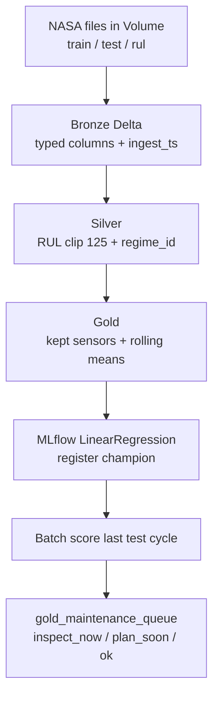

# Project flow (one page)

| Day | You do | Artifact |
| --- | --- | --- |
| 1 | Upload FD001, run ingest, profile | `bronze_*` |
| 2 | Silver + quality | `silver_cycles` |
| 3 | Gold + GitHub PR | `gold_features` |
| 4 | Train + CI | MLflow run + RMSE |
| 5 | Score + findings + prod approval | planner table + `docs/findings.md` |
